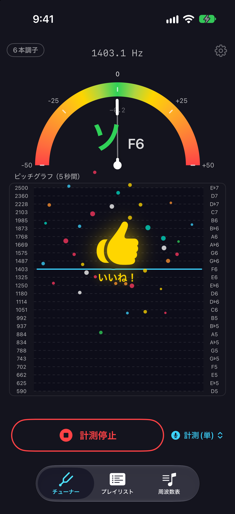
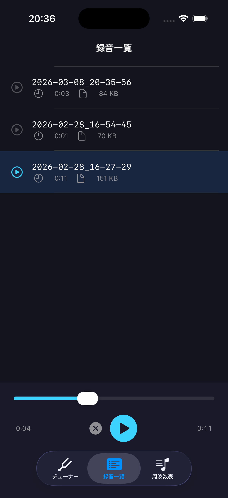

# 篠笛チューナー

篠笛（六本調子・八本調子）用のリアルタイムチューナーアプリ（iOS）

---

## 概要

端末のマイクから音を拾い、ピッチ（Hz）と音階をリアルタイムで表示します。
演奏した音が基準周波数からどれだけズレているかをセント単位で視覚的にフィードバックするほか、演奏を録音・再生する機能も備えています。

- 基準音: **A4 = 442 Hz**（六本調子・八本調子に対応）
- 音律: **12平均律**
- 音階表示: 運指名（筒音・一〜七 など）・階名（ドレミ。移動ド／固定ドを切り替え可）・音名（C D E F G A B）を表示

---

## 主な機能

### チューナー機能
- **初回起動時の調子選択**: マイク許可の問い合わせ後、お使いの篠笛の調子を選ぶ画面を1回だけ表示する（あとから設定で変更可）。
- マイクからピッチ（Hz）・音階・セントをリアルタイム表示し、セントメーター・成功エフェクト・5秒ピッチグラフ（表示は設定で On/Off）に対応する。**30秒間無音が続くと自動停止**（計測・録音共通）。
- **ソロモニタリング（計測・単）**: 単旋律向けのチューニング成功判定（許容セント・継続時間は設定で変更）。
- **アンサンブルモニタリング（計測・複）**: 合奏向け。開始前にカウントダウンし、スペクトル幅と安定性を含めた判定を行う。
- **調子表示**: 画面左上に選択中の調子（例「8本調子」）を表示し、タップでチューニング設定を開く。
- **チューニング設定**: 調子・階名（移動ド／固定ド）・ピッチグラフ表示・成功判定のセント範囲・継続時間・アンサンブル用の調整項目などを変更でき、設定は UserDefaults に保存される。

### 録音機能
- **計測**: ピッチ検出のみ。**録音**: ピッチ検出に加え m4a を保存。モードはボタンで切り替え。
- ファイル名は録音開始日時（例: `2026-02-26_21-30-00.m4a`）。

### プレイリスト機能
- 保存済みファイルを一覧表示し、タップで再生。下部にコントロールバー（再生・一時停止・停止・シーク）を表示。スワイプで削除・リネーム・共有など。
- 録音保存後、一覧を自動更新する。

### 周波数表
- 選択中の調子（六本調子・八本調子）の運指と各音の周波数をアプリ内で一覧できる。調子・階名（移動ド／固定ド）は画面右上の設定から変更できる。

詳細は [docs/specification.md](docs/specification.md) を参照。

---

## スクリーンショット

<p align="center">
  
  
</p>

---

## 技術スタック

| カテゴリ | 内容 |
|---|---|
| 言語 | Swift |
| UI フレームワーク | SwiftUI |
| 非同期処理 | Combine |
| 音声入力 | AVFoundation (AVAudioEngine) |
| ピッチ検出 | Accelerate (FFT + HPS) |
| 音声録音 | AVAudioFile (AAC/m4a) |
| 音声再生 | AVAudioEngine + AVAudioPlayerNode |
| 外部ライブラリ | なし |

### ピッチ検出アルゴリズム
- **FFT**（高速フーリエ変換）: Accelerate の `vDSP_fft_zrip` / ハン窓 / FFTサイズ 4096
- **HPS**（倍音積スペクトル法）: 倍音数3で基音を正確に検出
- **放物線補間**: HPS で求めたピーク付近を元のパワースペクトル（対数）で補間し、サブビン精度の周波数を算出
- 有効音域: **100 Hz 〜 3000 Hz**（八本調子の大甲音域 4'/F7 ≈ 2807 Hz をカバー）
- ノイズ判定: RMS < 0.003 で無音とみなす

---

## アーキテクチャ

**MVVM + Clean Architecture**（Presentation / Domain / Data の3層構成）

```
Presentation ──依存──▶ Domain ◀──依存── Data
```

| 層 | 役割 |
|---|---|
| Presentation | View + ViewModel。画面表示と状態管理。Domain のプロトコルにのみ依存 |
| Domain | Model + Repository Protocol + UseCase。ビジネスロジック。外部依存なし |
| Data | DataSource + Repository 実装。AVAudioEngine / FFT などの実装詳細を隠蔽 |

---

## プロジェクト構造

```
shinobuetuner/
├── ShinobuetunerApp.swift
├── Domain/                  # ビジネスロジック（外部依存なし）
│   ├── Model/               # NoteInfo, PitchSample, TunerSettings, PlaybackFile など
│   ├── Repository/          # Repository プロトコル
│   └── UseCase/             # MonitorPitchUseCase, FetchPlaybackFilesUseCase など
├── Data/                    # AVAudioEngine / FFT などの実装詳細
│   ├── DataSource/          # MicrophoneDataSource, AudioPlayerDataSource,
│   │                        # AudioFileDataSource（テスト用・Debug のみ）
│   └── Repository/          # Repository プロトコルの具体実装
└── Presentation/            # 画面表示と状態管理
    ├── ViewModel/           # TunerViewModel, TunerSettingsViewModel, TuningSelectionViewModel,
    │                        # PlaybackListViewModel, PlaybackSettingsViewModel, FrequencyTableViewModel
    └── View/
        ├── Common/          # 複数画面で共用する部品（調子・階名の設定セクション）
        ├── Onboarding/      # 初回起動時の調子選択画面
        ├── Turner/          # チューナー画面（TunerMainScreen, CentsMeterView など）
        ├── Playback/        # 再生一覧・再生コントロール画面
        └── FrequencyTable/  # 篠笛 音階周波数表（調子に合わせて表示）

shinobuetunerTests/          # ユニットテスト（Swift Testing）
└── Resources/               # テスト用音源（音階の .m4a）

docs/test/
├── maestro/                 # Maestro の E2E テストフロー
└── scripts/                 # テスト用音源の生成スクリプト
```

---

## 動作環境

| 項目 | 内容 |
|---|---|
| iOS | 26.0 以上 |
| Xcode | 26.0 以上 |
| 外部依存 | なし（CocoaPods / Swift Package Manager 不要） |
| 必要な権限 | マイク（NSMicrophoneUsageDescription） |

---

## セットアップ

### Xcode で開発する場合

1. リポジトリをクローン

```bash
git clone https://github.com/seabat/shinobue-tuner-ios.git
```

2. Xcode でプロジェクトを開く

```bash
open shinobue-tuner-ios/shinobuetuner.xcodeproj
```

3. ビルド & 実行

- Xcode でターゲットデバイスを選択してビルド（⌘R）
- マイクの使用許可を求めるダイアログが表示されるので「許可」を選択
- 続けて調子選択画面が表示されるので、調子を選んで「決定」をタップ（初回のみ）

### VS Code で開発する場合

#### 必要な拡張機能

`.vscode/extensions.json` に推奨拡張機能が定義されています。プロジェクトを VS Code で開くと自動的にインストールを促すポップアップが表示されます。

| 拡張機能 | 用途 |
|---|---|
| [Swift (swiftlang.swift-lang)](https://marketplace.visualstudio.com/items?itemName=swiftlang.swift-lang) | コード補完・定義ジャンプ・リファクタリング |
| [SweetPad (sweetpad.sweetpad)](https://marketplace.visualstudio.com/items?itemName=sweetpad.sweetpad) | iOS シミュレーターでのビルド・実行・デバッグ |

#### 初回セットアップ

```bash
# 依存ツールのインストール
brew install xcode-build-server xcbeautify

# SourceKit-LSP 用の設定ファイルを生成（プロジェクトルートで実行）
xcode-build-server config -project shinobuetuner.xcodeproj -scheme shinobuetuner
```

#### ビルド & 実行

- `Cmd + Shift + B` — ビルド（`Debug`）
- `Cmd + Shift + P` → `SweetPad: Launch App` — シミュレーターで起動

---

## テスト

テストは次の2種類がある。

| 種類 | 手段 | 確認すること |
|---|---|---|
| ユニットテスト | Swift Testing（`shinobuetunerTests/`） | 音名・運指名・階名の変換、調子選択、ピッチ検出の精度 |
| 画面表示の E2E テスト | Maestro（`docs/test/maestro/`） | 音を入力したとき、チューナー画面に正しい名前が表示されること |

### テスト用音源

ピッチ検出と画面表示のテストでは、音階（移動ドの ド〜ド）を1音1秒ずつ鳴らした 8 秒の .m4a を使う。音源は `shinobuetunerTests/Resources/` にある。

| ファイル | 調子 | 音 |
|---|---|---|
| `rokuhon_scale.m4a` | 六本調子 | B♭5 C6 D6 E♭6 F6 G6 A6 B♭6 |
| `hachihon_scale.m4a` | 八本調子 | C6 D6 E6 F6 G6 A6 B6 C7 |

作り直すときは ffmpeg を使うスクリプトを実行する（引数は調子の本数）。

```bash
docs/test/scripts/generate_scale_m4a.sh 6   # 六本調子
docs/test/scripts/generate_scale_m4a.sh 8   # 八本調子
```

### A. ユニットテスト（ピッチ検出を含む）

運指名・階名などローカライズされた文字列を検証するため、**日本語ロケールで実行する**。

```bash
xcodebuild test -scheme shinobuetuner \
  -destination 'platform=iOS Simulator,name=iPhone 17' \
  -only-testing:shinobuetunerTests \
  -testLanguage ja -testRegion JP
```

| テスト | 内容 |
|---|---|
| `NoteHelperTuningTests` | 六本調子・八本調子の運指名・音名・階名（移動ド／固定ド）・周波数が比較表と一致すること |
| `TuningSelectionTests` | 初回起動時の調子選択の表示判定と保存 |
| `ScaleAudioPitchDetectionTests` | テスト用音源をピッチ検出に通し、8音が順番どおりに検出され、運指名・階名・音名が正しく、ずれが ±5 セント以内であること（六本調子・八本調子） |

### B. 画面表示の E2E テスト（Maestro）

テスト用音源をマイクの代わりに入力し、チューナー画面に 8 音それぞれの「運指名 → 階名 → 音名」が並んで表示されることを確認する。

シミュレータのマイクに音声ファイルを流し込む標準の方法はないので、**Debug ビルドの起動引数 `-UITestAudioFile <ファイル名>`** でマイクの代わりに音声ファイルを入力にしている（`AudioFileDataSource`）。音源はループ再生し、スピーカーからは鳴らさない。ピッチ検出は本番と同じ処理を通る。

| フロー | 内容 |
|---|---|
| `docs/test/maestro/tuner_scale_rokuhon.yaml` | 六本調子の音源で確認する |
| `docs/test/maestro/tuner_scale_hachihon.yaml` | 八本調子の音源で確認する |

事前に [Maestro](https://maestro.dev/) をインストールしておく。シミュレータは 1 台だけ起動しておく（手順 3・4 は起動中のシミュレータを対象にするため）。

1. Debug ビルドをシミュレータにインストールする
2. アプリを起動してマイク権限を許可し、調子を選択する
3. 音源をアプリのデータ領域の `Library/UITestAudio/` にコピーする（起動中のシミュレータが対象）

   ```bash
   DATA_DIR=$(xcrun simctl get_app_container booted dev.seabat.ios.shinobuetuner data) &&
     mkdir -p "$DATA_DIR/Library/UITestAudio" &&
     cp shinobuetunerTests/Resources/*_scale.m4a "$DATA_DIR/Library/UITestAudio/"
   ```

4. フローを実行する（`<UDID>` は `xcrun simctl list devices booted` で確認する）

   ```bash
   maestro --device <UDID> test docs/test/maestro/tuner_scale_rokuhon.yaml docs/test/maestro/tuner_scale_hachihon.yaml
   ```

- 調子・階名（移動ド）はフローが起動引数で指定する。手順 2 で選ぶ調子はどれでもよい
- 1フローあたり約30秒かかる。成功すると `[Passed] チューナー音階テスト（六本調子）` のように表示される
- 起動引数で渡した設定は保存されている設定より優先される。普段どおり使うときは、引数なしで起動し直す
- アプリをアンインストールするとコピーした音源も消えるので、もう一度コピーする

詳しい経緯と設計は [docs/plans/scale_audio_tuner_test_implementation.md](docs/plans/scale_audio_tuner_test_implementation.md) を参照する。

---

## ロードマップ

- 六本調子・八本調子以外の調子（本数）への対応
- 音量（dB）メーターの追加
- 再生中に篠笛のピッチ解析をリアルタイム表示（再生モードのチューナー連携）
- Beethoven ライブラリの導入（より高精度なピッチ検出）

---

## ライセンス

MIT License
